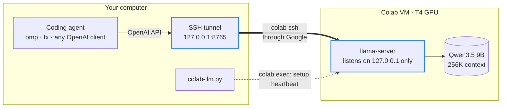
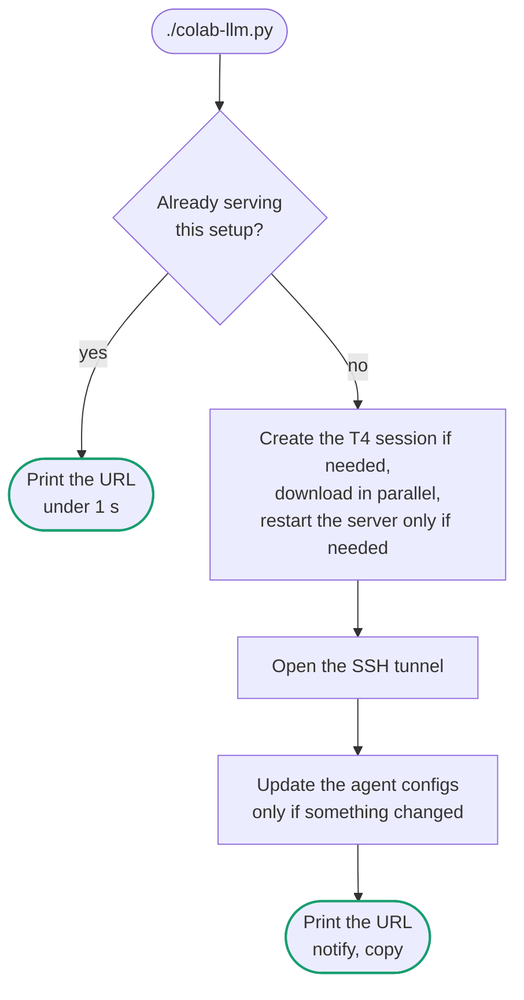
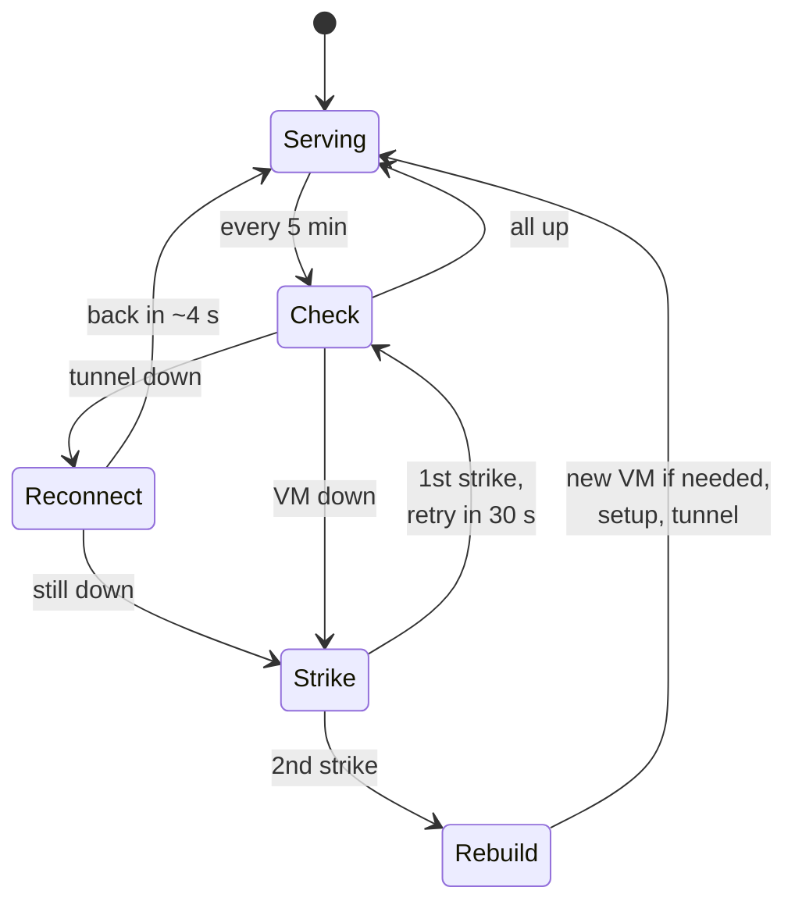

# colab-llm

`colab-llm.py` runs an uncensored ("abliterated") Qwen model with
[llama.cpp](https://github.com/ggml-org/llama.cpp) on a free Google Colab T4 GPU. It makes
the model available on your computer as an OpenAI-compatible endpoint, so coding agents
and other OpenAI clients can use it. It can also register the endpoint with the
[omp](https://github.com/can1357/oh-my-pi) and [fx](https://github.com/vercel-labs/fx)
coding agents.

The default setup gives you:

- A 262144-token (256K) context window. The model finds facts anywhere in a 200K-token
  prompt.
- About 25 tokens per second with an empty context, and about 19 tokens per second at
  98K tokens of context.
- A private endpoint at `http://127.0.0.1:8765/v1` that does not change between runs.

<picture>
  <source media="(prefers-color-scheme: dark)" srcset="docs/img/speed-dark.svg">
  
</picture>

The script is one Python file with no dependencies outside the standard library.
PyYAML is needed only for the omp registration.

## Requirements

- The [`colab` CLI](https://pypi.org/project/google-colab-cli/), signed in to a Google
  account that can get a T4 GPU. To check the account, run `colab whoami`.
- An SSH key at `~/.ssh/id_ed25519` or `~/.ssh/id_ecdsa`. `colab ssh` sends it to the VM.
- Python 3.10 or later and OpenSSH. The script is tested on Linux.
- Optional: `notify-send` and `wl-copy`. When the endpoint is ready, the script shows a
  desktop notification and copies the URL.

## Quick start

1. Start the model:

   ```sh
   ./colab-llm.py
   ```

   The first run takes about 3 minutes. It creates the VM, downloads llama.cpp and the
   model, and loads the model. Later runs in the same session take less than 1 second.

2. Use the endpoint. The script prints it:

   ```text
   BASE_URL=http://127.0.0.1:8765/v1
   MODEL=abliterated
   ```

   - omp: `omp --model uncensored/abliterated`
   - fx: `fx provider uncensored`, then `fx`
   - Any OpenAI client: set `OPENAI_BASE_URL=http://127.0.0.1:8765/v1` and
     `OPENAI_API_KEY=none`.

3. When you finish, stop the VM. A running VM uses your Colab GPU quota, even when idle.

   ```sh
   ./colab-llm.py --stop
   ```

## Commands

| Command | What it does |
|---|---|
| `./colab-llm.py` | Uses the running server if it matches. If not, sets it up. Prints the URL. |
| `./colab-llm.py --status` | Checks the endpoint. Does not call Colab. |
| `./colab-llm.py --watch` | Keeps the VM alive and repairs the tunnel, the server, or the session when one fails. |
| `./colab-llm.py --watch --stop-on-exit` | Same as `--watch`, but Ctrl-C also stops the VM. |
| `./colab-llm.py --stop` | Closes the tunnel and stops the VM. |
| `./colab-llm.py --model 14b` | Serves the 14B model. Both models stay cached on the VM. |
| `./colab-llm.py --ctx 131072` | Overrides the context size of the model. |
| `./colab-llm.py --think` | Lets the model think before it answers. See [Thinking](#thinking). |
| `./colab-llm.py --tunnel cloudflare` | Uses a public HTTPS URL instead of the SSH tunnel. |
| `./colab-llm.py --port 9000` | Uses a different local port for the SSH tunnel. |
| `./colab-llm.py --no-register` | Does not write the omp and fx configs. |

To use more than one VM, give each one a name with `--session NAME`.

## Models

| Name | Model | File | Default context | Trained context |
|---|---|---|---|---|
| `9b` (default) | Huihui Qwen3.5 9B abliterated, Q4_K_M | 5.24 GiB | 262144 | 262144 |
| `14b` | Huihui Qwen3 14B abliterated v2, Q4_K_M | 8.38 GiB | 32768 | 40960 |

Use `9b` for agents and coding. It is faster at every context size, and it is the only
model that can hold more than 40K tokens. See [Benchmarks](#benchmarks).

The models are community fine-tunes of Qwen models with refusals removed, published by
[huihui-ai](https://huggingface.co/huihui-ai) and quantized to GGUF by
[mradermacher](https://huggingface.co/mradermacher). Read their model cards for license
terms and limitations. You are responsible for how you use them.

To serve a different GGUF model, add an entry to `MODELS` in `colab-llm.py`.

## Thinking

Both models can think (reason step by step) before they answer. Thinking is off by
default, because it makes replies much slower on a T4:

<picture>
  <source media="(prefers-color-scheme: dark)" srcset="docs/img/thinking-dark.svg">
  
</picture>

| Task | Thinking off | Thinking on |
|---|---|---|
| "What is 17*23?" | 4 tokens | 1481 tokens |
| "Write a palindrome function" | 6.6 s (149 tokens) | 32 s (766 tokens) |

To turn it on for all requests, run `./colab-llm.py --think`. The server restarts, and
the omp config marks the model as a reasoning model. A client can also turn thinking on
for one request: send `"chat_template_kwargs": {"enable_thinking": true}`.

## How it works



Each run of the script follows this path:



"This setup" means the same model, context size, and thinking setting.

In detail:

1. The script makes sure that the Colab session exists. If not, it creates one with a T4.
2. It sends a bootstrap script to the VM kernel with `colab exec`. The bootstrap:
   1. Starts the model download in the background. The download resumes if an earlier
      run stopped.
   2. Downloads llama.cpp and checks that the GPU is visible.
   3. Starts `llama-server`, or keeps the running one if it has the same arguments.
   4. Prints progress lines (`[vm] ...`). The script shows them as they arrive.
3. The script opens the tunnel and checks the endpoint from your computer.
4. If the URL or the context changed, the script writes the `uncensored` provider to
   `~/.omp/agent/models.yml` and `~/.fx/settings.json`. It does not change your active
   fx provider.

`llama-server` listens only on `127.0.0.1` on the VM. Only the tunnel can reach it.

The script keeps a small state file in `~/.cache/colab-llm/` and an SSH control socket in
`$XDG_RUNTIME_DIR`. The fast path uses them: if the tunnel is open and the server has the
model and context that you asked for, the script prints the URL and exits.

### Recovery with `--watch`

Colab stops a VM whose kernel is idle, and a network outage closes the SSH tunnel.
`--watch` handles both. It repairs the cheapest thing first, and it rebuilds only after
two failed checks in a row, so one slow check never costs you a new VM.



### Tunnels

The default tunnel is SSH (`colab ssh --proxy-mode`) with a local port forward. The SSH
process runs in the background after the script exits, so the endpoint stays available.

<picture>
  <source media="(prefers-color-scheme: dark)" srcset="docs/img/tunnel-dark.svg">
  
</picture>

| | SSH (default) | Cloudflare quick tunnel |
|---|---|---|
| URL | `http://127.0.0.1:8765/v1`. It never changes. | A new `https://*.trycloudflare.com` URL for each tunnel. |
| Access | Only your computer. | Public. The script adds a secret path prefix. |
| Agent configs | Written once. | Written again after each new tunnel. |
| Time to first token | 571 ms | 976 ms |
| Reconnect after a failure | 3.6 s | About 15 s, or about 100 s if your DNS resolver caches the failed lookup. |
| Request time limit | None | About 100 s without response bytes. See [Tunnel performance](#tunnel-performance). |
| Needs a process on your computer | Yes | No |

Use `--tunnel cloudflare` when another computer must reach the model.

## Benchmarks

All results are from one Colab T4 (15360 MiB) in October 2026, with llama.cpp build
b11696, flash attention on, and all layers on the GPU. Your results can be different:
Colab VMs vary, and a T4 slows down when it gets hot. The raw data is in `bench/results/`.

### Choosing the context size

This rule was set before the benchmarks ran. The default context is the largest size
that meets all three conditions:

1. It fits on the T4 with at least 1 GiB of VRAM free.
2. Generation speed at 75% fill is at least half the speed with an empty context. Agents
   fill their context as they work, so the speed at depth matters more than the speed
   at depth 0.
3. It is not larger than the trained context. Past that size, quality drops.

**9b: 262144.** It fits with 1.6 GiB free. At 200K (75% fill), generation is 15.6 tokens
per second, which is 61% of the empty-context speed. This value comes from the needle
test, which generates only about 7 tokens per answer, so treat it as an estimate. The Qwen3.5 hybrid attention keeps
the KV cache small, so speed drops slowly as the context fills.

**14b: 32768.** At 40960, only 0.5 GiB stays free. At 24K (75% of 32768), generation is
82% of the empty-context speed.

### VRAM use

<picture>
  <source media="(prefers-color-scheme: dark)" srcset="docs/img/vram-dark.svg">
  
</picture>

MiB used after the model loads, out of 15360 MiB:

| Model | KV cache | 16384 | 32768 | 40960 | 65536 | 131072 | 204800 | 262144 |
|---|---|---|---|---|---|---|---|---|
| 9b | f16 | | | | 7357 | 9469 | 11845 | **13693** |
| 9b | q8_0 | | | | 6613 | 8021 | 9605 | 10837 |
| 14b | f16 | 11007 | **13583** | 14871 | | | | |
| 14b | q8_0 | 9809 | 11221 | 11941 | 14101 | | | |

### Speed against context depth

The chart at the top of this page shows the generation speeds below.

Tokens per second, from `llama-bench` (512-token prompt, 128 generated tokens). Most rows
come from interleaved runs in ABBA order (f16, q8_0, q8_0, f16). That order cancels the
effect of the T4 heating up and slowing down during a run. Rows marked with * come from
a run without interleaving, so compare them only with each other.

**9b**

| Depth | Generation, f16 | Generation, q8_0 | Prompt, f16 | Prompt, q8_0 |
|---|---|---|---|---|
| 0 | 25.3 | 24.9 | 947 | 947 |
| 32768 | 21.9 | 19.3 | 689 | 679 |
| 98304 | 19.3 | 12.8 | 419 | 433 |
| 131072 * | | 10.9 | | 368 |
| 196608 * | | 8.2 | | 201 |

**14b**

| Depth | Generation, f16 | Generation, q8_0 | Prompt, f16 | Prompt, q8_0 |
|---|---|---|---|---|
| 0 | 14.6 | 14.7 | 605 | 595 |
| 16384 | 12.5 | 9.8 | 299 | 310 |
| 24576 * | 11.5 | 8.2 | 250 | 245 |

Results:

- **Use the f16 KV cache.** With an empty context, f16 and q8_0 are equally fast. As the
  context fills, q8_0 gets slower: at 98K on 9b, it generates 33% slower. q8_0 only
  saves VRAM, and both defaults fit in f16.
- **Keep flash attention on.** At 16K on 9b, flash attention off cuts prompt speed from
  795 to 516 tokens per second, and generation from 22.5 to 16.4.
- **The context is shared.** llama-server runs 4 request slots that share one 262144-token
  cache. One request can use all of it. If an agent sends several large requests at
  the same time, for example from subagents, they can run out of space together.
- **A long prompt is slow on a T4.** A full 200K-token prompt takes about 7.5 minutes to
  process. llama-server caches the prompt, so in a normal agent session only the new
  tokens need processing. But when an agent changes the start of its prompt, for
  example after compaction, the full context runs again.

### Long-context retrieval

`bench/needle.py` hides a number at a position in filler text and asks the model for it.
This test checks that the model still uses a long context, not only that it is fast.

<picture>
  <source media="(prefers-color-scheme: dark)" srcset="docs/img/needle-dark.svg">
  
</picture>

Results for 9b with the default settings (f16 KV cache, 262144 context). The speeds are
from the server, for a full prompt without the cache:

| Prompt tokens | Needle position | Result | Prompt tokens/s | Generation tokens/s | Time |
|---|---|---|---|---|---|
| 32031 | 10% | PASS | 637 | 25.2 | 52 s |
| 32032 | 50% | PASS | 806 | 22.0 | 42 s |
| 32031 | 90% | PASS | 818 | 23.2 | 42 s |
| 128007 | 50% | PASS | 555 | 17.9 | 3.9 min |
| 199959 | 25% | PASS | 446 | 15.4 | 7.6 min |
| 199959 | 75% | PASS | 447 | 15.7 | 7.6 min |

The model finds the needle at every size and position that was tested. At 200K tokens,
it still generates at 15.6 tokens per second.

### Tunnel performance

Measured on a CPU Colab VM against the same server, with the two tunnels interleaved.
Median and 95th percentile in ms:

| Metric | Cloudflare | SSH |
|---|---|---|
| Health check, new connection | 799 / 1276 | 511 / 551 |
| Health check, kept-alive connection | 299 / 339 | 258 / 297 |
| Upload 256 KiB | 1319 / 2138 | 1280 / 1310 |
| Time to first token, real llama-server | 976 | 571 |
| Streamed tokens per second | 13.5 | 13.5 |

Both tunnels stream tokens at the speed of the server.

Cloudflare closes a request with HTTP 524 when the server sends nothing for about
100 seconds. With this model, that happens to a request that does not stream and has a
prompt larger than about 64K tokens: a 128K prompt failed after 126 seconds. A streamed
128K request worked, because the server sends its headers early. Most agents stream,
but the SSH tunnel has no such limit.

An early test with a synthetic server showed Cloudflare holding back a whole stream
(`bench/results/tunnel-synthetic-cpu.txt`, "stream first chunk"). That result came from
the test server. Real llama-server output streams through Cloudflare without delay. A model at 25 tokens per second
sends only a few KB per second, and that is far below what either tunnel can carry. The
SSH tunnel wins on latency, stability, and privacy.

### Run the benchmarks again

To redraw the charts from `bench/results/`, run `python3 docs/make_charts.py`.

```sh
# Tunnels: start bench/tunnel_server.py on the VM, then compare two base URLs.
bench/tunnel_bench.py cloudflare=https://NAME.trycloudflare.com ssh=http://127.0.0.1:8001
bench/stream_bench.py cloudflare=https://NAME.trycloudflare.com/v1 ssh=http://127.0.0.1:8765/v1

# Speed and VRAM fit: run on the VM after the models download.
scp -o ControlPath=$XDG_RUNTIME_DIR/colab-llm-llm.sock bench/gpu_bench.sh bench/kv_ab.sh x:/content/
ssh -S $XDG_RUNTIME_DIR/colab-llm-llm.sock x 'mkdir -p /content/bench && setsid nohup bash /content/gpu_bench.sh > /content/bench/run.log 2>&1 &'

# Long-context retrieval, through the running endpoint.
bench/needle.py http://127.0.0.1:8765 --tokens 32000,128000 --depths 0.1,0.5,0.9
```

## Troubleshooting

**"Colab has no T4 for this account right now."** The account has reached its free GPU
limit, or Colab has no free T4s. Try again later. `--watch` retries until it gets a GPU.

**The endpoint stops after a network outage.** The outage closes the SSH tunnel. Run
`./colab-llm.py` again. It reconnects in about 4 seconds and keeps the same URL. With
`--watch`, the repair is automatic.

**You need a shell on the VM.** Colab accepts only one `colab ssh` connection per VM,
and the tunnel uses it. Send the shell through the tunnel instead:

```sh
ssh -S $XDG_RUNTIME_DIR/colab-llm-llm.sock x
```

**Comments in `models.yml` are gone.** PyYAML does not keep comments. The script writes
the file only when the URL or the context changes, and the first time it changes a
file, it keeps your version as `models.yml.bak` or `settings.json.bak`. To skip the
agent configs completely, use `--no-register`.

**The VM stops while you use it.** Colab stops a VM when its kernel is idle. Requests to
the model do not count as kernel activity. Use `--watch`. It runs a small cell every 5
minutes.

## License

[MIT](LICENSE). The models have their own licenses; see their model cards.
